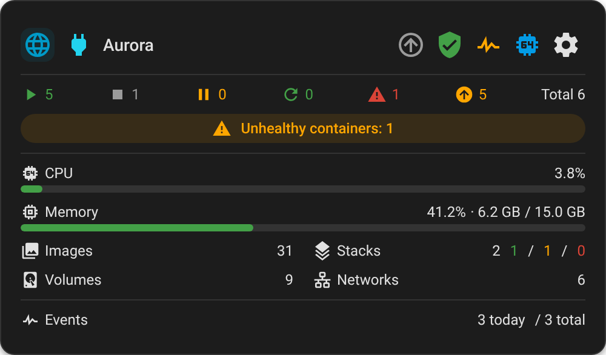
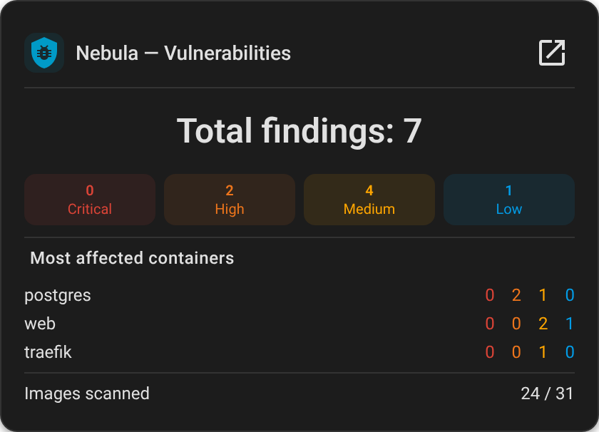
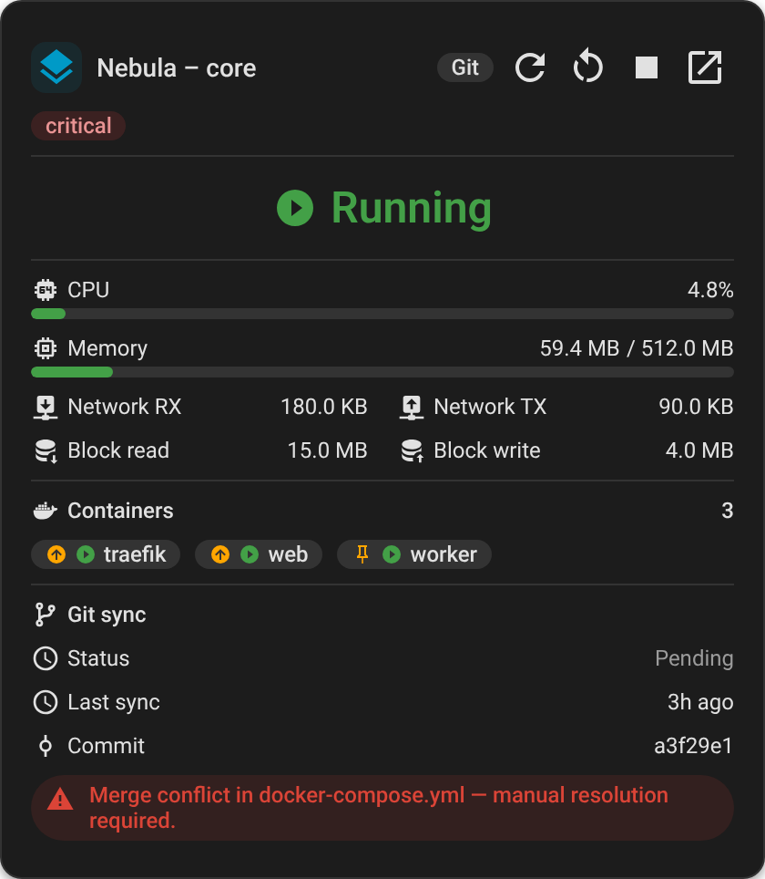
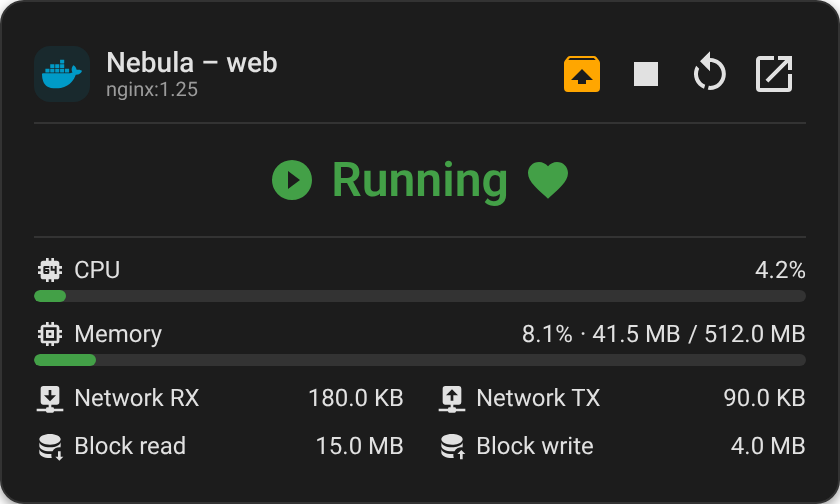
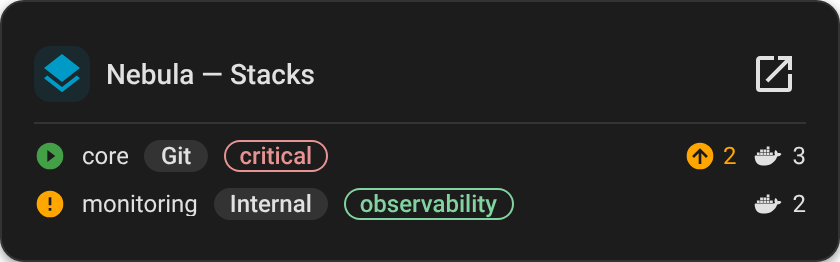
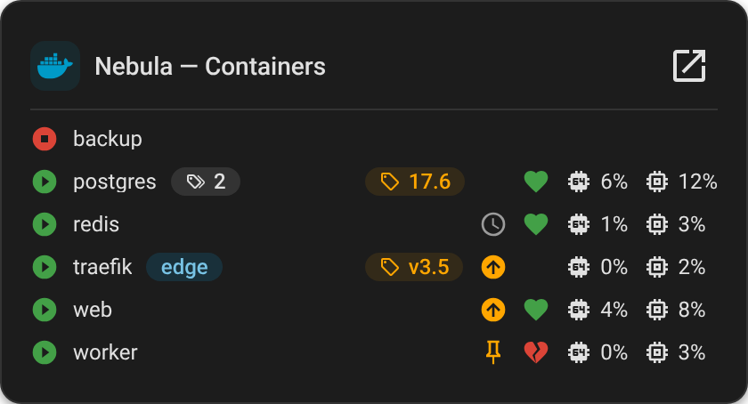
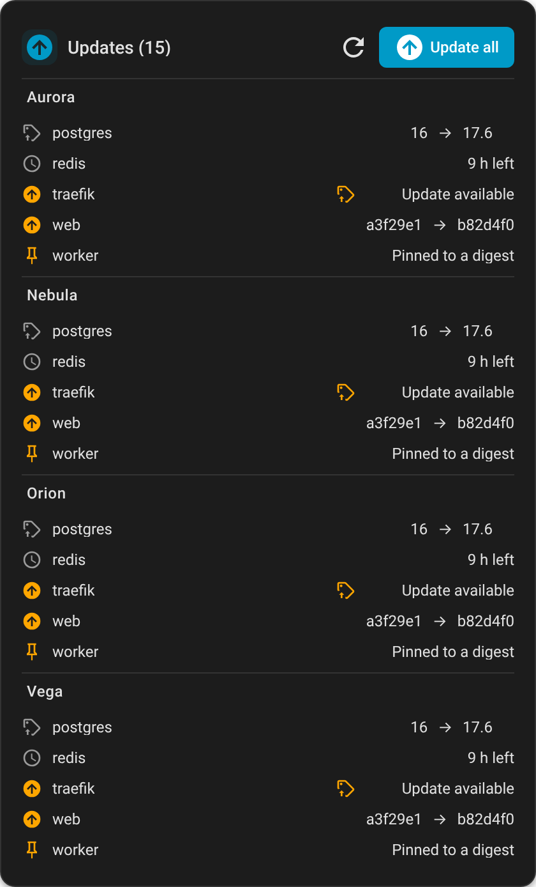
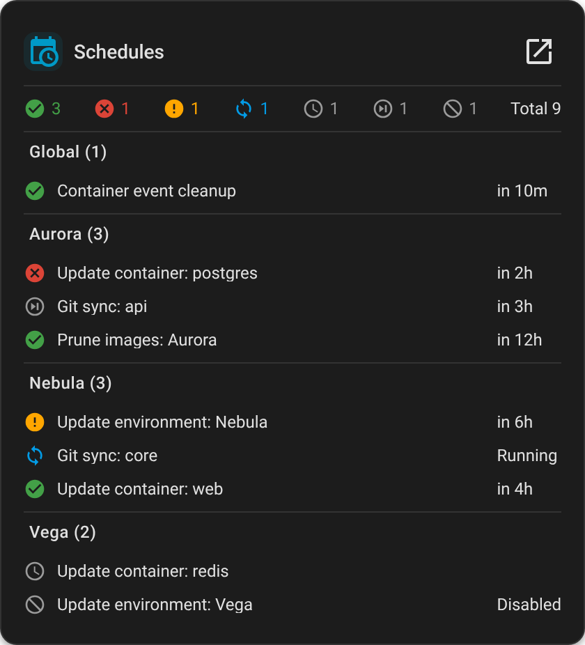
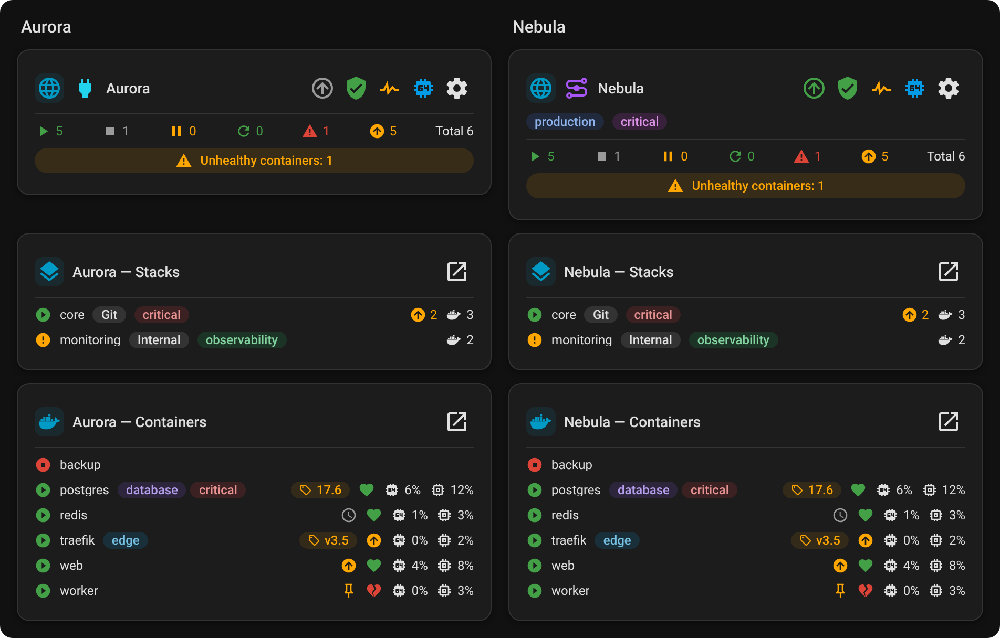
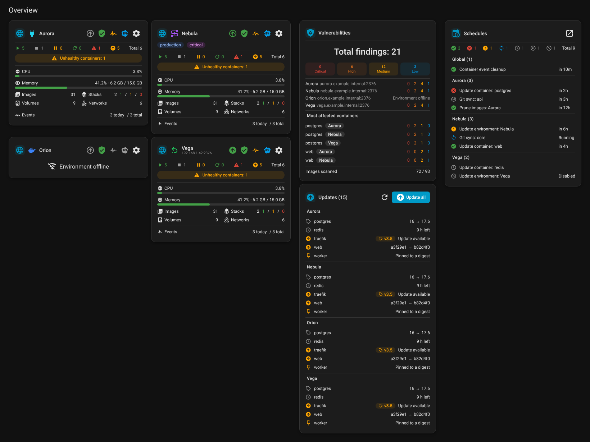

  

  

# Dockhand Cards for Home Assistant

Dashboard cards for **[Dockhand](https://dockhand.pro)** — a modern Docker management UI — modeled on Dockhand's own interface. Nine cards cover your environments, stacks, containers, pending updates, vulnerabilities and schedules, from a single compact tile up to a whole-dashboard overview, and a ready-made **[Dockhand dashboard](#dockhand-dashboard)** lays them all out for you, with a page per environment and its stacks and containers.

The cards are built on the entities from the **[Dockhand integration](https://github.com/raetha/ha-dockhand)**, which needs to be installed first. They only read what Home Assistant already has, so they need no credentials of their own and never contact Dockhand directly.

---

## Requirements

- Home Assistant 2026.8 or later
- The [Dockhand integration](https://github.com/raetha/ha-dockhand) 2.0.0 or later, whose counts and sizes are sensors of their own (earlier releases kept them as attributes, which these cards no longer read)

---

## Installation

### Marketplace (Recommended)

Dockhand Cards is in the default catalog of Home Assistant's **Marketplace**, built in from Home Assistant 2026.11 (it grew out of HACS, and uses the same catalog).

1. Go to **Settings → Marketplace**
2. Find **Dockhand Cards** (a **Dashboard** item) and install it. The Marketplace adds the dashboard resource for you
3. Refresh your browser. If your dashboard resources are managed in YAML, add `/local/community/ha-dockhand-cards/ha-dockhand-cards.js` as a **JavaScript Module** yourself

**Home Assistant 2026.10 and older** have no Marketplace: install [HACS](https://hacs.xyz) yourself, then the steps are the same in HACS (**HACS → Frontend**, find Dockhand Cards, download it, refresh). HACS's resource path is `/hacsfiles/ha-dockhand-cards/ha-dockhand-cards.js`.

### Manual

1. Download every `.js` file from the [latest release](https://github.com/raetha/ha-dockhand-cards/releases): the cards (`ha-dockhand-cards.js`), their editors (`ha-dockhand-cards-editor.js`) and one `ha-dockhand-cards-i18n-<language>.js` per language
2. Copy them all into the same folder, e.g. `<HA config>/www/`. The editor and language files are loaded automatically from beside the card file, so they don't need resources of their own (a missing language file just shows English)
3. Add the card file as a dashboard resource: `/local/ha-dockhand-cards.js`, type **JavaScript Module**
4. When updating, replace all the files and add or bump a version on the resource URL, e.g. `/local/ha-dockhand-cards.js?v=2.0.0`, so browsers load the new files

### Test builds

Upcoming changes are published as test builds (pre-releases such as `2.0.1-dev.42`) before they're released, for anyone willing to try them early:

1. Turn on pre-releases for Dockhand Cards: in the Marketplace, open Dockhand Cards and use its **⋮** menu, or turn on the Dockhand Cards **Pre-release** switch (**Settings → Devices & services → Entities**; it's disabled by default, so enable it first). On HACS only the switch is there.
2. The latest test build is then offered as an update; install it and refresh your browser
3. To go back to releases, turn pre-releases off again, then open Dockhand Cards, choose **⋮ → Redownload** and pick the latest release

The browser console shows which version is loaded (`HA-DOCKHAND-CARDS v1.5.1-dev.42`); include it when reporting a problem. The changes in a test build are listed in its [release notes](https://github.com/raetha/ha-dockhand-cards/releases).

---

## Cards

Rather than placing cards yourself, you can let the [Dockhand dashboard](#dockhand-dashboard) build a whole dashboard from them. Or add any card from the dashboard's **Add card** dialog — search for "Dockhand", or open a Dockhand device or entity and use its suggested cards. Every card has a visual editor, and all of them share a few things:

- **No entity setup.** Pick an environment, stack or container and the card finds its entities.
- **Missing data is left out.** A disabled sensor or an older integration release hides that value rather than breaking the card; the editor tells you what to enable for more.
- **Everything opens.** Any value backed by an entity opens that entity's details when clicked.
- **Your icons and colors.** Entity icons follow your customizations, and colors follow your Home Assistant theme (see [Styling](https://github.com/raetha/ha-dockhand-cards/blob/main/docs/styling.md)).

Singular names (Stack, Container) show one item; plural ones (Stacks, Containers) list every item across the environments you choose, and [choose environments and filter lists](https://github.com/raetha/ha-dockhand-cards/blob/main/docs/cards/lists.md) the same way. The screenshots use made-up data.

### Dockhand Environment Card

One environment at a glance, from a compact tile to its full details: container counts, CPU and memory, resources, events, disk usage and history, with header icons to turn its update checks, scanning and collection on and off. **[Options and details](https://github.com/raetha/ha-dockhand-cards/blob/main/docs/cards/environment.md)**

<picture>
  <source media="(prefers-color-scheme: light)" srcset="docs/images/env-standard-light.png">
  
</picture>

### Dockhand Vulnerability Card

Vulnerability findings by severity, for one environment or added up across several. **[Options and details](https://github.com/raetha/ha-dockhand-cards/blob/main/docs/cards/vulnerability.md)**

<picture>
  <source media="(prefers-color-scheme: light)" srcset="docs/images/vulnerability-light.png">
  
</picture>

### Dockhand Stack Card

One stack: its status, resource use, containers and Git sync, with start, stop, restart and deploy buttons. **[Options and details](https://github.com/raetha/ha-dockhand-cards/blob/main/docs/cards/stack.md)**

<picture>
  <source media="(prefers-color-scheme: light)" srcset="docs/images/stack-light.png">
  
</picture>

### Dockhand Container Card

One container: its state, health and resource use, with start, stop and restart buttons. **[Options and details](https://github.com/raetha/ha-dockhand-cards/blob/main/docs/cards/container.md)**

<picture>
  <source media="(prefers-color-scheme: light)" srcset="docs/images/container-light.png">
  
</picture>

### Dockhand Stacks Card

Every stack in the environments you choose, a compact row each, grouped, sorted and filtered as you like. **[Options and details](https://github.com/raetha/ha-dockhand-cards/blob/main/docs/cards/stacks.md)**

<picture>
  <source media="(prefers-color-scheme: light)" srcset="docs/images/stacks-list-light.png">
  
</picture>

### Dockhand Containers Card

Every container in the environments you choose, a row each with its state, health, updates and CPU/memory, grouped, sorted and filtered as you like. **[Options and details](https://github.com/raetha/ha-dockhand-cards/blob/main/docs/cards/containers.md)**

<picture>
  <source media="(prefers-color-scheme: light)" srcset="docs/images/containers-list-light.png">
  
</picture>

### Dockhand Updates Card

Every pending container update, with Check for updates and Update all. **[Options and details](https://github.com/raetha/ha-dockhand-cards/blob/main/docs/cards/updates.md)**

<picture>
  <source media="(prefers-color-scheme: light)" srcset="docs/images/updates-light.png">
  
</picture>

### Dockhand Schedules Card

Every Dockhand schedule with its status and next run, and optional Run now and enable/disable buttons. **[Options and details](https://github.com/raetha/ha-dockhand-cards/blob/main/docs/cards/schedules.md)**

<picture>
  <source media="(prefers-color-scheme: light)" srcset="docs/images/schedules-light.png">
  
</picture>

### Dockhand Overview Card

A whole dashboard in one card: a column per environment, with the cards you choose in each. **[Options and details](https://github.com/raetha/ha-dockhand-cards/blob/main/docs/cards/overview.md)**

<picture>
  <source media="(prefers-color-scheme: light)" srcset="docs/images/overview-light.png">
  
</picture>

Suggestions for what the cards should show are welcome: open an issue.

## Dockhand dashboard

A ready-made dashboard instead of building one card by card: in **Settings → Dashboards → Add dashboard**, pick **Dockhand** under Community dashboards. Home Assistant builds it from these cards each time it opens, so it keeps up by itself as environments, stacks and containers come and go in Dockhand.

An overview of your environments, with vulnerabilities, updates and schedules beside them; a page for each environment with all its cards; and pages with a card for each of its stacks and containers. Columns, cards and each card's settings are chosen in the dashboard's own settings. **[Pages, settings and YAML](https://github.com/raetha/ha-dockhand-cards/blob/main/docs/dashboard.md)**

<picture>
  <source media="(prefers-color-scheme: light)" srcset="docs/images/dashboard-overview-light.png">
  
</picture>

---

## Translations

Every card and editor is translated into the same languages as the integration: German, Spanish, French, Italian, Norwegian, Dutch, Polish, Portuguese, Swedish and Chinese (Simplified), alongside English, following your Home Assistant language. Numbers and times ("5 min ago") follow your language and number format too. Each language is its own small file beside the cards, so a dashboard only loads the one it shows. Translations are machine-generated; corrections from native speakers are welcome — see [CONTRIBUTING.md](CONTRIBUTING.md).

---

## Accessibility

Everything clickable works from the keyboard (Tab to move, Enter or Space to activate) and has a name a screen reader can announce; this is checked automatically for every card and editor. Status colors come from your Home Assistant theme, so the cards match the rest of your dashboard — if you need higher-contrast colors, a theme that provides them applies here too. If something isn't usable with your setup, please open an issue.

---

## Contributing

See [CONTRIBUTING.md](CONTRIBUTING.md) for how to report issues and send changes, and [development.md](docs/development.md) for setup, testing against a real Home Assistant instance, and how releases and test builds work. How the cards work and why is in [architecture.md](docs/architecture.md); ideas already considered are in [backlog.md](docs/backlog.md).

---

## Attribution

These cards were developed by **[@raetha](https://github.com/raetha)** with design assistance and code generation by **[Claude](https://claude.ai)** (Anthropic).

---

## License

MIT

## Removal

1. Remove the Dockhand cards from your dashboards.
2. In **Settings → Marketplace** (or **HACS → Frontend** on 2026.10 and older), find **Dockhand Cards** and remove it; that removes its dashboard resource too. For a manual install, delete its files and remove the resource under **Settings → Dashboards → ⋮ → Resources**.
3. Refresh your browser.
