[](https://github.com/hacs/default)
[](https://github.com/raetha/ha-dockhand-cards/releases)
[](https://github.com/raetha/ha-dockhand-cards/actions/workflows/build.yml)

<p align="center">
  
</p>

# Dockhand Cards for Home Assistant

Dashboard cards for **[Dockhand](https://dockhand.pro)** — a modern Docker management UI — modeled
on Dockhand's own interface. Nine cards cover your environments, stacks, containers, pending
updates, vulnerabilities and schedules, from a single compact tile up to a whole-dashboard
overview.

The cards are built on the entities from the **[Dockhand integration](https://github.com/raetha/ha-dockhand)**,
which needs to be installed first. They only read what Home Assistant already has, so they need no
credentials of their own and never contact Dockhand directly.

---

## Requirements

- Home Assistant 2026.6 or later
- The [Dockhand integration](https://github.com/raetha/ha-dockhand) 1.8.0 or later. A few features
  need a newer release; on an older one they're simply left out:

  | Feature | ha-dockhand |
  |---|---|
  | Schedules grouped by environment | 1.9.0 |
  | "Hide when no updates" counting a system container's own update | 1.8.2 |
  | Update counts including new version tags | 1.10.2 |
  | Newer version tags, moved pinned digests and held updates | 1.11.0 |

---

## Installation

### HACS (Recommended)

This repository is available in the default HACS catalog.

1. Open HACS in Home Assistant
2. Go to **Frontend**
3. Search for **Dockhand Cards** and install it
4. Refresh your browser. If the cards don't appear, add the resource below under
   **Settings → Dashboards → ⋮ → Resources**

[](https://my.home-assistant.io/redirect/hacs_repository/?owner=raetha&repository=ha-dockhand-cards&category=plugin)

### Manual

1. Download `ha-dockhand-cards.js` and `ha-dockhand-cards-editor.js` from the
   [latest release](https://github.com/raetha/ha-dockhand-cards/releases)
2. Copy both into the same folder, e.g. `<HA config>/www/`. The editor file is loaded automatically
   from beside the card file, so it doesn't need a resource of its own
3. Add the card file as a dashboard resource: `/local/ha-dockhand-cards.js`, type
   **JavaScript Module**
4. When updating, replace both files and add or bump a version on the resource URL, e.g.
   `/local/ha-dockhand-cards.js?v=1.4.0`, so browsers load the new files

### Test builds

Upcoming changes are published as test builds (pre-releases such as `v1.5.1-dev.42`) before
they're released, for anyone willing to try them early. To get them through HACS:

1. Go to **Settings → Devices & services → Entities**, search for the Dockhand Cards
   **Pre-release** switch that HACS creates (it's disabled by default), and enable it
2. Turn the switch on. HACS then offers the latest test build as an update; install it and
   refresh your browser
3. To go back to releases, turn the switch off, then in HACS open Dockhand Cards, choose **⋮ →
   Redownload** and pick the latest release

The browser console shows which version is loaded (`HA-DOCKHAND-CARDS v1.5.1-dev.42`); include it
when reporting a problem. The changes in a test build are listed in its
[release notes](https://github.com/raetha/ha-dockhand-cards/releases).

---

## Cards

Add any card from the dashboard's **Add card** dialog — search for "Dockhand", or open a Dockhand
device or entity and use its suggested cards. Every card has a visual editor, and all of them share
a few things:

- **No entity setup.** Pick an environment, stack or container and the card finds its entities.
- **Missing data is left out.** A disabled sensor or an older integration release hides that value
  rather than breaking the card; the editor tells you what to enable for more.
- **Everything opens.** Any value backed by an entity opens that entity's details when clicked.
- **Your icons and colors.** Entity icons follow your customizations, and colors follow your
  Home Assistant theme (see [Styling](docs/styling.md)).

The screenshots use made-up data.

### Dockhand Environment Card

```yaml
type: custom:dockhand-environment-card
device_id: <environment device>
mode: standard # compact | standard | detailed | full | custom
custom_sections: [container_counts, metrics, resources, events_summary] # only used when mode: custom
name: null # optional — Composed (from the device's area/name/floor) or Custom (plain text);
           # unset uses the device's own name, as on every card
show_settings_link: true # link to open this environment in Dockhand
```

Four built-in layouts, plus your own:

- **Compact** — name, online status and container counts
- **Standard** — adds CPU/memory, health, resource counts and events (Dockhand's own dashboard tile)
- **Detailed** — adds the top containers by CPU and recent events
- **Full** — adds a disk usage breakdown and a 15-minute CPU/memory history chart
- **Custom** — pick exactly which of those sections to show

<p>
  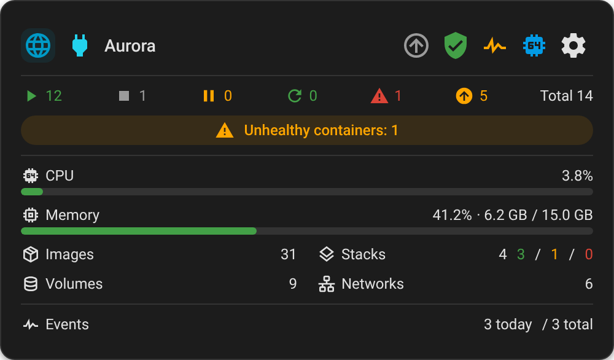
  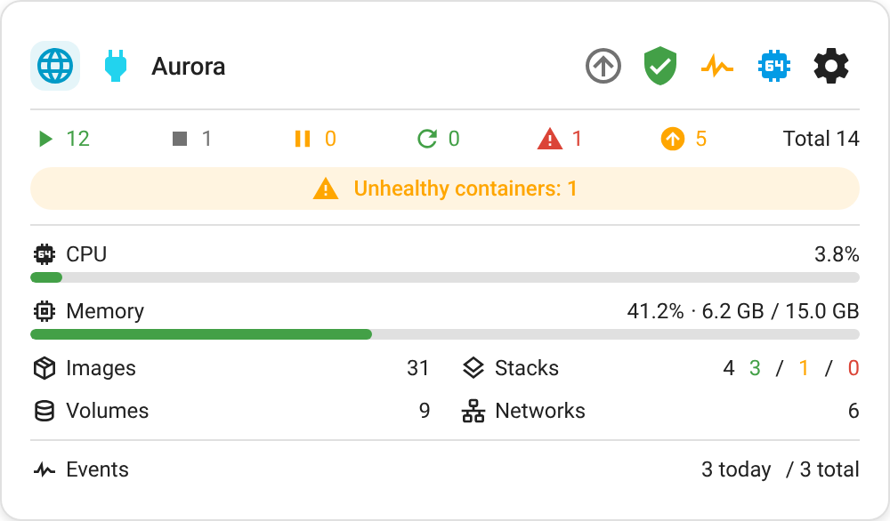
</p>

<details>
<summary>Compact, detailed, and full modes</summary>
<p>
  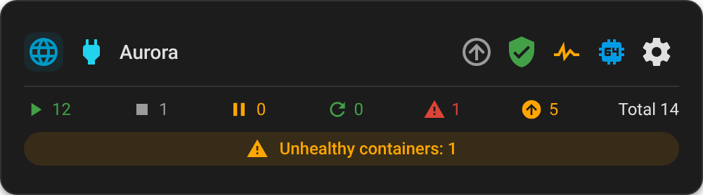
  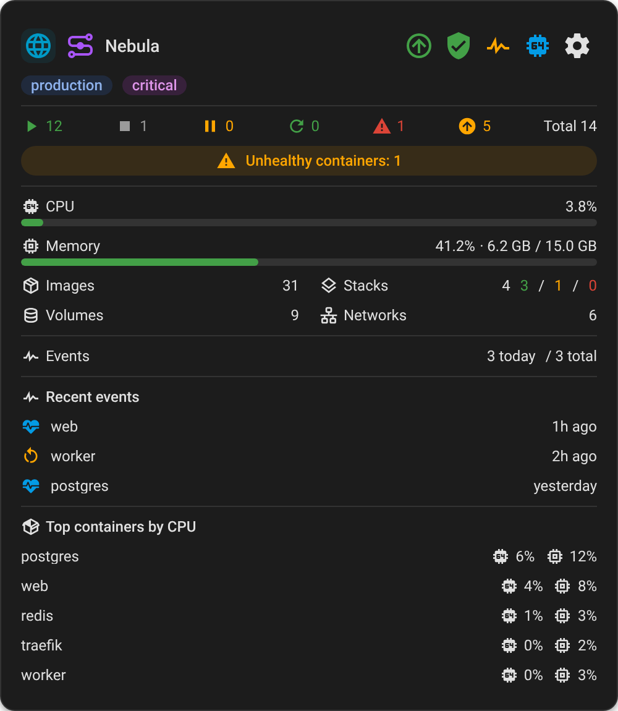
  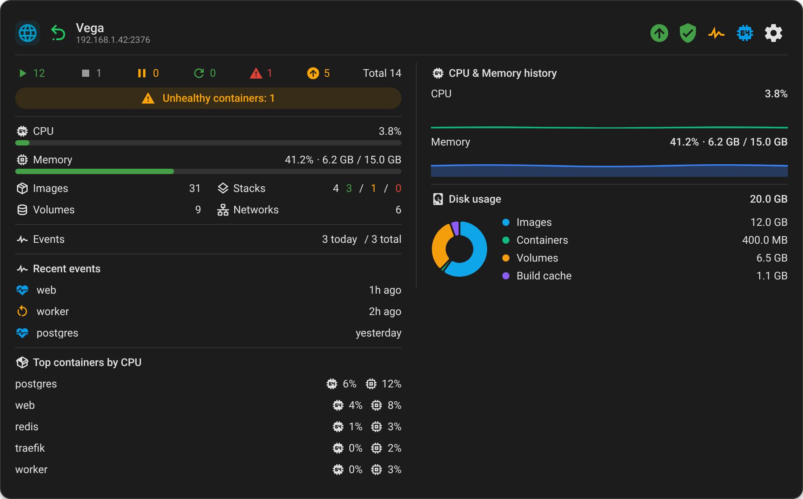
</p>
</details>

### Dockhand Vulnerability Card

```yaml
type: custom:dockhand-vulnerability-card
device_id: <environment device>
name: null # optional — Composed or Custom, same as the Environment card's own Name field
show_settings_link: true # link to view vulnerabilities in Dockhand
```

Total findings with a critical/high/medium/low breakdown, and how many images have been scanned.
Needs the environment's **Vulnerabilities** sensor enabled in Home Assistant (it's disabled by
default) and vulnerability scanning turned on for that environment in Dockhand.

<p>
  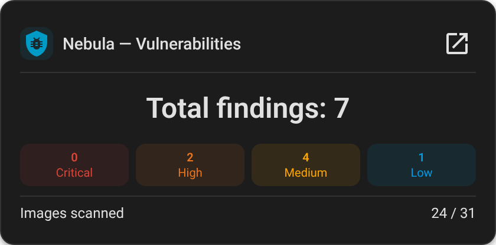
  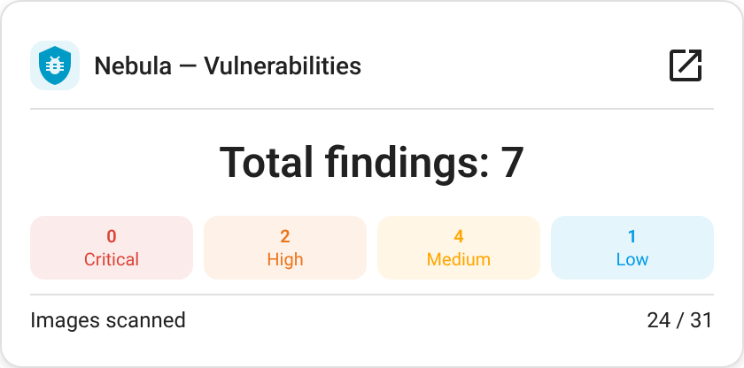
</p>

### Dockhand Stack Card

```yaml
type: custom:dockhand-stack-card
device_id: <stack device>
name: null # optional — Composed or Custom, same as every other card's Name field
icon: null # optional — custom header icon (e.g. mdi:layers-triple); defaults to mdi:layers
show_settings_link: true # link to open this stack in Dockhand
show_controls: true # row of start/stop/restart buttons under the status — off hides it
visible_sections: [status, metrics, io, containers, git_sync] # which sections show, independent of each other
```

The stack's status, CPU/memory and network/disk I/O totals, its containers (each one a pill that
opens that container), pending updates, and — for git stacks — sync status, last sync time and any
sync error. The totals are Dockhand's own (the same numbers its Stacks page shows), from
ha-dockhand 1.11.0's stack stats sensors — they need Dockhand 1.0.52 or later and ha-dockhand's
**Enable container and stack stats** option; without them the card simply leaves those sections out. Like
Dockhand, memory shows as usage over limit, where the limit is the largest single container limit
(usually the host's memory).

A row of buttons under the status starts, stops or restarts the stack, alongside its **Redeploy**
(internal stacks) or **Deploy / Sync from Git** (git stacks) button. Everything except Start asks
for confirmation first. A stack containing a system container (Dockhand itself, or a Hawser agent)
has no buttons, matching Dockhand.

<p>
  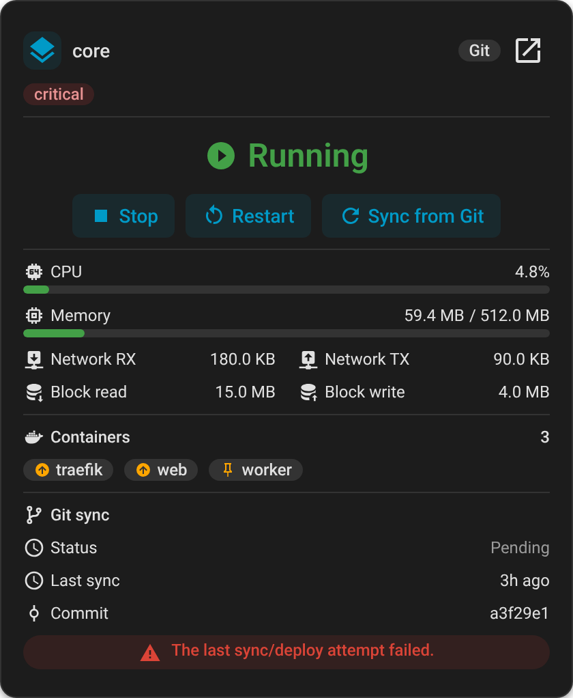
  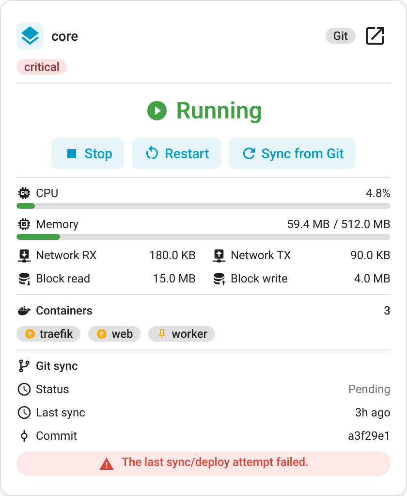
</p>

### Dockhand Container Card

```yaml
type: custom:dockhand-container-card
device_id: <container device>
name: null # optional — Composed or Custom, same as every other card's Name field
icon: null # optional — custom header icon (e.g. mdi:server); defaults to mdi:docker
show_settings_link: true # link to open this container in Dockhand
show_controls: true # row of start/stop/restart buttons under the status — off hides it
visible_sections: [state, metrics, io] # which sections show, independent of each other
```

The container's state, health (when it has a healthcheck), CPU/memory and network/disk I/O. CPU,
memory and I/O need ha-dockhand's **Enable container and stack stats** option; without it the card simply
leaves them out, and its editor tells you what to enable.

A row of buttons under the state starts, stops or restarts the container, asking for confirmation
before Stop or Restart. System containers (Dockhand itself, or a Hawser agent) have no buttons,
matching Dockhand.

<p>
  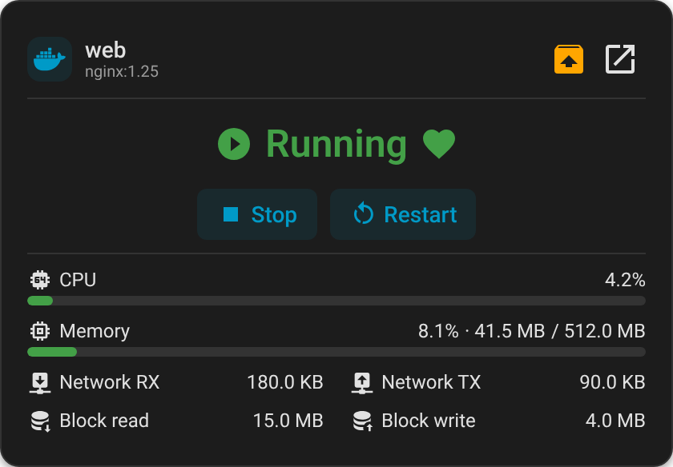
  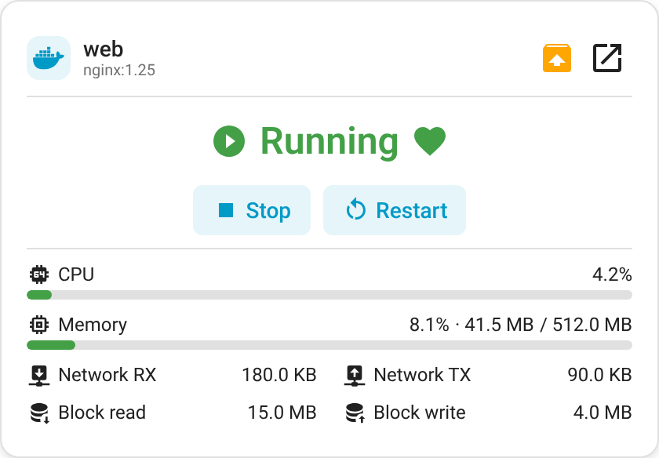
</p>

> Singular card names (Stack, Container) show one item; plural ones (Stacks, Containers) list every
> item across the environments you choose. Suggestions for what the single-item cards should show
> are welcome — open an issue.

### Dockhand Stacks Card

```yaml
type: custom:dockhand-stacks-card
environments_order: [] # environment display order; all environments are included by default
exclude_device_ids: [] # environments to leave out
name: null # optional — Composed or Custom, same as every other card's Name field
show_settings_link: true # link to view stacks in Dockhand
visible_badges: [container_count, updates, type] # per-row details; add `environment` for an environment pill
group_by: environment # none | environment | status | type
sort_by: name # name | status
```

Every stack in one environment, several, or all of them, one compact row each: status, type,
container count and pending updates. Each of those details can be turned off under **Row details**
in the editor. Choosing environments works the same way on every multi-environment card — see
[Choosing environments](#choosing-environments) below.

Older configs using a single `device_id` keep working as before.

<p>
  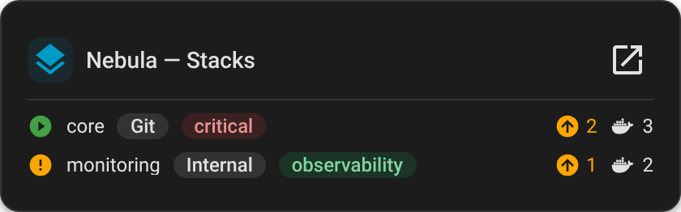
  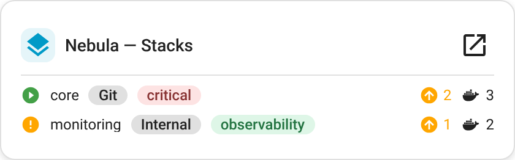
</p>

### Dockhand Containers Card

```yaml
type: custom:dockhand-containers-card
environments_order: [] # environment display order; all environments are included by default
exclude_device_ids: [] # environments to leave out
name: null # optional — Composed or Custom, same as every other card's Name field
show_settings_link: true # link to view containers in Dockhand
visible_badges: [health, updates, cpu, memory] # per-row details; add `environment` for an environment pill
group_by: environment # none | environment | status
sort_by: name # name | status
```

Every container in one environment, several, or all of them, one compact row each: state, health,
pending updates and CPU/memory (when container stats are enabled). Works like the Stacks card
above, including **Row details** and older `device_id` configs.

With ha-dockhand 1.11.0 or later, a newer version tag Dockhand has found shows as a tag pill, like
Dockhand's own containers list: next to the update icon when there's also an update to install, or
on its own when there isn't. A container pinned to a digest whose tag has moved on gets an orange
pin in the update icon's place, and one whose update Dockhand is holding until the new image
reaches its minimum image age gets a grey clock; hover either for the details. All of these are
part of the **updates** row detail.

<p>
  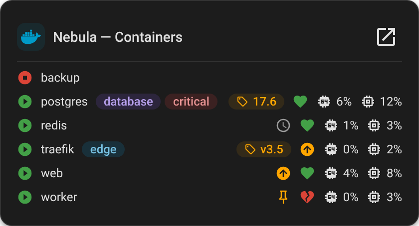
  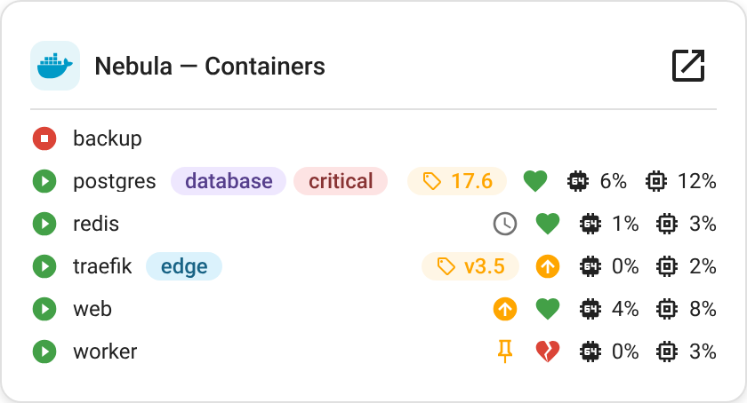
</p>

### Dockhand Updates Card

```yaml
type: custom:dockhand-updates-card
group_by: environment # none | environment
environments_order: [] # environment display order; all environments are included by default
exclude_device_ids: [] # environments to leave out
name: null # optional — Composed or Custom, same as every other card's Name field
hide_when_no_updates: false # hide the whole card when nothing is pending (still shown while editing)
```

Every pending container update across the environments you choose, with **Check for updates**
and **Update all** buttons in the header. Update all presses each environment's own ha-dockhand
Update all button, so it behaves exactly like Dockhand's: system containers are left out. Click a
row to open that container's update dialog and install just that one.

A newer version tag (one you'd move to by changing the container's image tag rather than installing
from Home Assistant) gets a grey tag icon in place of the update icon when it's the row's only
update. When it's waiting behind an update that can be installed now, it shows as a tag pill
alongside that update. Two more kinds of row, both as Dockhand's own containers list shows them: a
container pinned to a digest (`image:tag@sha256:…`) whose tag has moved on gets an orange pin and
"Pinned to a digest" (the update is changing the pin, so there's nothing to install), and an update
Dockhand is holding until the new image reaches its minimum image age gets a grey clock and the
hours left, so you can see it coming ("At next check" once the wait is over, until Dockhand's next
update check offers it). Both count in the header, and keep the card showing when **Hide when no
updates** is on. Needs ha-dockhand 1.11.0 or later.

Updates are grouped by environment by default; `group_by: none` shows one combined list. Older
configs using `scope`/`device_id` keep working as before.

<p>
  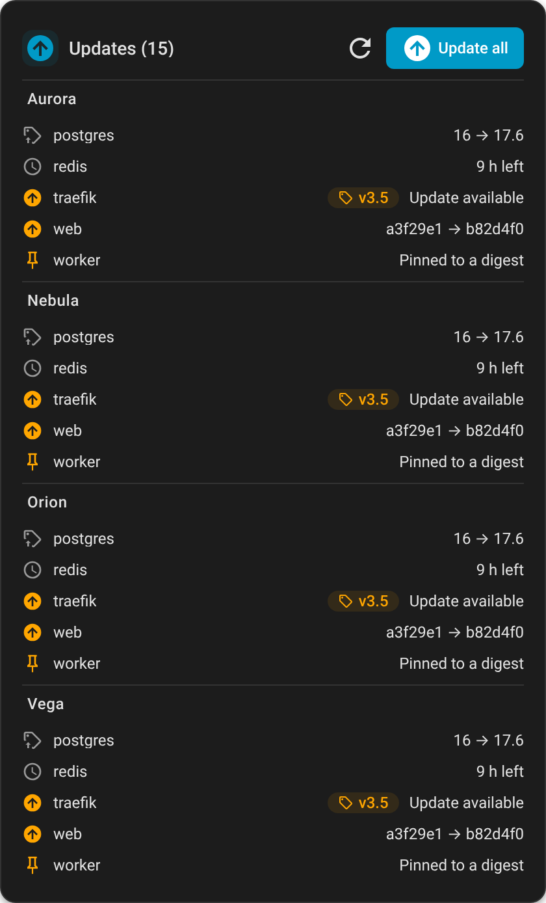
  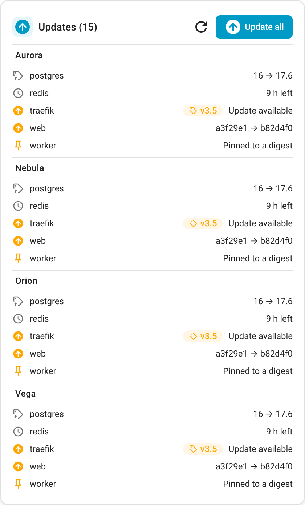
</p>

### Dockhand Schedules Card

```yaml
type: custom:dockhand-schedules-card
group_by: environment # none | environment | type | status
sort_by: status # name | next_run | status
environments_order: [] # environment display order; all environments are included by default
exclude_device_ids: [] # environments to leave out
include_global: true # also show global schedules (ones not tied to an environment)
name: null # optional — Composed or Custom, same as every other card's Name field
show_settings_link: true # link to view schedules in Dockhand
show_stats: true # row of counts: success, failed, warning, running, queued, skipped, disabled, total
visible_badges: [next_run, environment] # per-row details (the environment pill is hidden when grouped by environment)
```

Every Dockhand schedule — container auto-updates, git stack syncs, update checks, image prunes,
backups and system jobs — for the environments you choose, with each one's status and next run.
Grouping schedules by environment needs ha-dockhand 1.9.0 or later; on older releases every
schedule shows regardless of the environments chosen.

<p>
  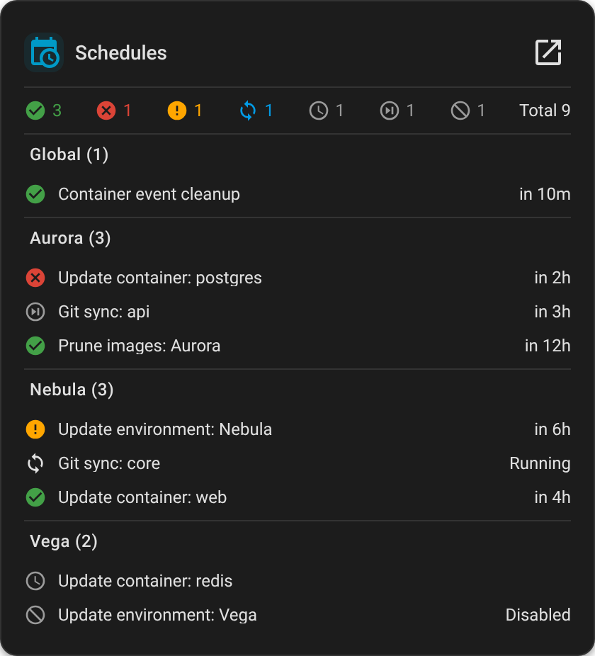
  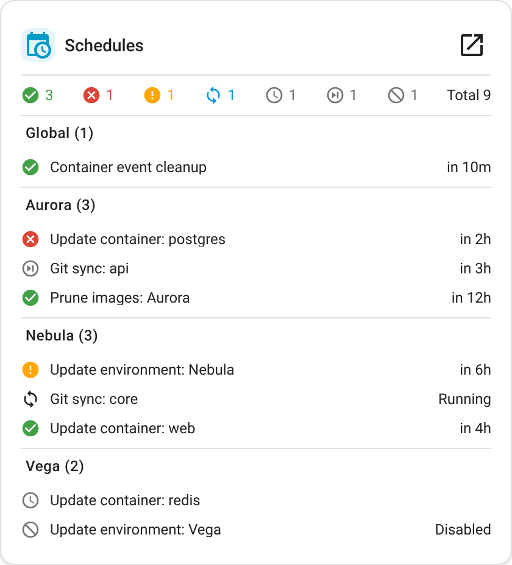
</p>

### Choosing environments

Every multi-environment card (Stacks, Containers, Updates, Schedules and Overview) has the same
**Environments** section in its editor:

- **Drag** to reorder — sets the order of environment groups
- **Eye icon** to include or leave out one environment
- **Target icon** to show only that environment
- **Show all / Clear** to include every environment, or start from none

### Dockhand Overview Card

```yaml
type: custom:dockhand-overview-card
show_environments: true
show_vulnerabilities: false # needs the Vulnerabilities sensor enabled per environment
show_updates: false
updates_hide_when_no_updates: false # hide an environment's Updates card when it has nothing pending
show_schedules: false # each column shows its own environment's schedules (needs ha-dockhand 1.9.0+)
show_stacks: false
show_containers: false
```

A whole dashboard in one card: one column per environment, each stacking the sections you turn
on — the Environment, Vulnerability, Updates, Schedules, Stacks and Containers cards, in that
order by default. Columns sit side by side on a wide screen and stack on a narrow one. Only
environments are shown by default, since with everything on the card gets tall quickly.

Both the environments and the sections can be dragged into a different order in the editor, and a
pencil icon on each opens more settings:

- **On a section** — defaults for that card type in every column, such as the Environment card's
  layout or which row details the Stacks and Containers cards show.
- **On an environment** — settings for just that environment's column, including a different name,
  stored under `environments_overrides`.

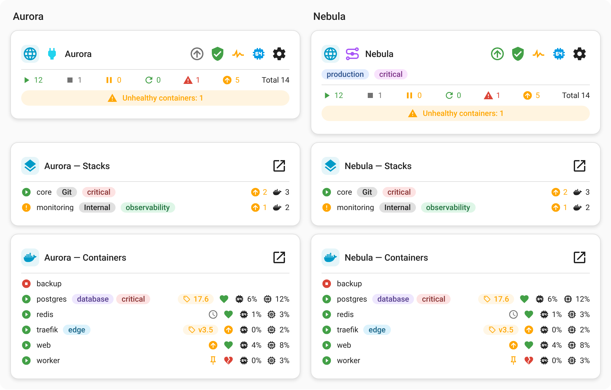

*Environments, Stacks and Containers turned on, across two environments.*

---

## Translations

Every card and editor is translated into the same languages as the integration: German, Spanish,
French, Italian, Norwegian, Dutch, Polish, Portuguese, Swedish and Chinese (Simplified), alongside
English, following your Home Assistant language. Numbers and times ("5 min ago") follow your
language and number format too. Translations are machine-generated; corrections from native
speakers are welcome — see [CONTRIBUTING.md](CONTRIBUTING.md).

---

## Accessibility

Everything clickable works from the keyboard (Tab to move, Enter or Space to activate) and has a
name a screen reader can announce; this is checked automatically for every card and editor. Status
colors come from your Home Assistant theme, so the cards match the rest of your dashboard — if you
need higher-contrast colors, a theme that provides them applies here too. If something isn't
usable with your setup, please open an issue.

---

## Contributing

See [CONTRIBUTING.md](CONTRIBUTING.md) for how to report issues and send changes, and
[development.md](docs/development.md) for setup, testing against a real Home Assistant instance,
and how releases and test builds work. How the cards work and why is in
[architecture.md](docs/architecture.md); ideas already considered are in
[backlog.md](docs/backlog.md).

---

## Attribution

These cards were developed by **[@raetha](https://github.com/raetha)** with design assistance and
code generation by **[Claude](https://claude.ai)** (Anthropic).

---

## License

MIT

## Removal

1. Remove the Dockhand cards from your dashboards.
2. In HACS, go to **Frontend**, find **Dockhand Cards**, and click **Remove**. For a manual install,
   delete both files and remove the resource under **Settings → Dashboards → ⋮ → Resources**.
3. Refresh your browser.
