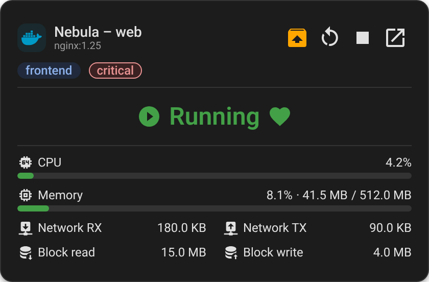

# Dockhand Container Card

[All cards](../../README.md#cards)

```yaml
type: custom:dockhand-container-card
device_id: <container device>
name: null # optional — Composed or Custom, same as every other card's Name field
icon: null # optional — custom header icon (e.g. mdi:server); defaults to mdi:docker
show_settings_link: true # link to open this container in Dockhand
show_controls: true # start/restart/pause/stop buttons in the header — off hides them
visible_sections: [state, metrics, io] # which sections show, independent of each other
```

Under the header, the container's Dockhand tags as coloured pills (when it has any), with its stack's after its own, as Dockhand's containers list shows them; see [Tags from the stack](containers.md#tags-from-the-stack). The container's state, health (when it has a healthcheck), CPU/memory and network/disk I/O. CPU, memory and I/O need ha-dockhand's **Enable container and stack stats** option; without it the card simply leaves them out, and its editor tells you what to enable.

Buttons in the header start (or resume, when paused), restart, pause and stop the container, in the order Dockhand's own containers list shows them, asking for confirmation before Stop or Restart. Pause appears only once the container's **Pause** entity is turned on in Home Assistant (it's disabled by default). System containers (Dockhand itself, or a Hawser agent) have no buttons, matching Dockhand.

<picture>
  <source media="(prefers-color-scheme: light)" srcset="../images/container-light.png">
  
</picture>
