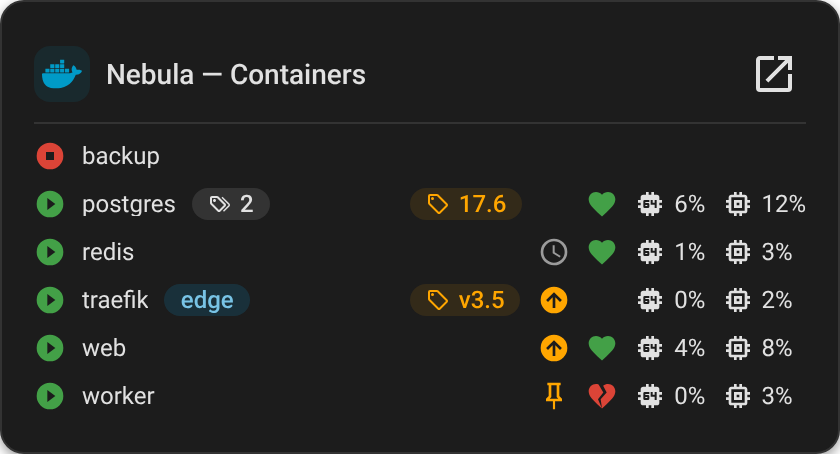
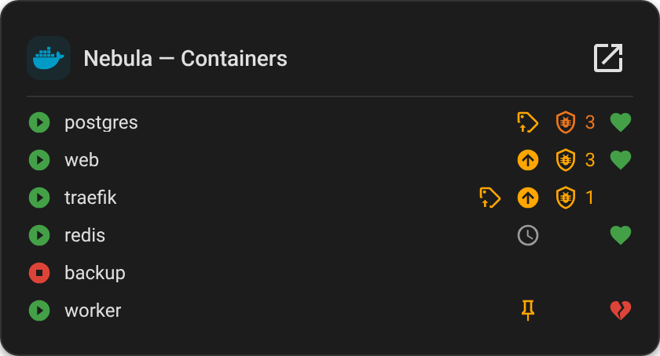

# Dockhand Containers Card

[All cards](../../README.md#cards)

```yaml
type: custom:dockhand-containers-card
environments_order: [] # environment display order; all environments are included by default
exclude_device_ids: [] # environments to leave out
name: null # optional — Composed or Custom, same as every other card's Name field
show_settings_link: true # link to view containers in Dockhand
visible_badges: [health, updates, cpu, memory, tags] # per-row details; add `environment` for an environment pill, `vulnerabilities` for each container's findings, `controls` for the Container card's buttons
group_by: environment # none | environment | status
sort_by: name # name | status | cpu | memory (highest first) | vulnerabilities (most severe first)
filters: {} # which rows show — see lists.md
show_filtered_count: true # a "Hidden by filters" line under a filtered list
```

Every container in one environment, several, or all of them, one compact row each: state, health, pending updates and CPU/memory (when container stats are enabled). Works like the [Stacks card](stacks.md), including **Row details** and their **Controls**.

A newer version tag Dockhand has found shows as a tag icon (hover for the tag): after the update icon when there's also an update to install, or on its own when there isn't. A container pinned to a digest whose tag has moved on gets an orange pin in the update icon's place, and one whose update Dockhand is holding until the new image reaches its minimum image age gets a grey clock; hover either for the details. All of these are part of the **updates** row detail.

The row details line up in columns down the card, one for each detail shown that some row has, each as wide as its widest value. On a row too narrow for everything, the name stays readable: tags that don't all fit fold into one pill with their count (hover for their names). The Stacks and Updates cards do the same.

<picture>
  <source media="(prefers-color-scheme: light)" srcset="../images/containers-list-light.png">
  
</picture>

## Vulnerabilities

With `vulnerabilities` among the row details, a container whose image has findings shows how many, in the colour of the most severe (hover for each severity's count, click for the sensor). Clean and unscanned images show nothing. `sort_by: vulnerabilities` puts the most severe first, as Dockhand ranks them. Both need ha-dockhand 2.2.0 with Dockhand 1.0.59 or later, and the containers' vulnerability sensors turned on (**Vulnerabilities** under **Container entities** in the integration's Configure); the editor says when they're off.

<picture>
  <source media="(prefers-color-scheme: light)" srcset="../images/containers-vulnerabilities-light.png">
  
</picture>

## Tags from the stack

A container shows its stack's Dockhand tags too, after its own, as Dockhand's containers list does by default. The pills say where each tag comes from:

- **Filled**: the container's own tag, assigned to it in Dockhand or named in its `dockhand.tags` label.
- **Outlined**: a tag assigned to its stack. Hover for the stack's name.
- **Filled and outlined**: on both the container and its stack.

The Stacks and Stack cards draw a stack's tags outlined too, so an outline means a stack's tag wherever you see it.

The **Tags** filter matches a container by its stack's tags too, as Dockhand's does. Dockhand can turn stack tags off in its containers list, but keeps that choice in your browser, where Home Assistant can't see it, so the cards always show them. A stack's own tags are only the ones assigned to it in Dockhand: tags its services name in their labels stay on those containers (ha-dockhand 2.1+).
