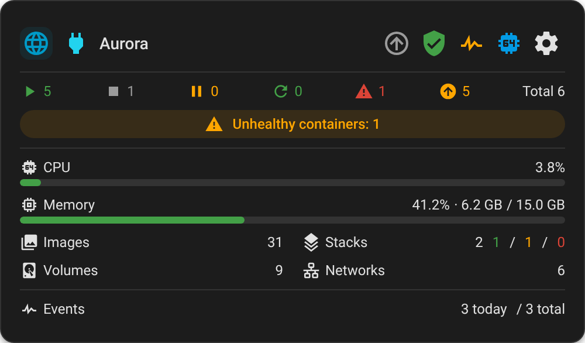
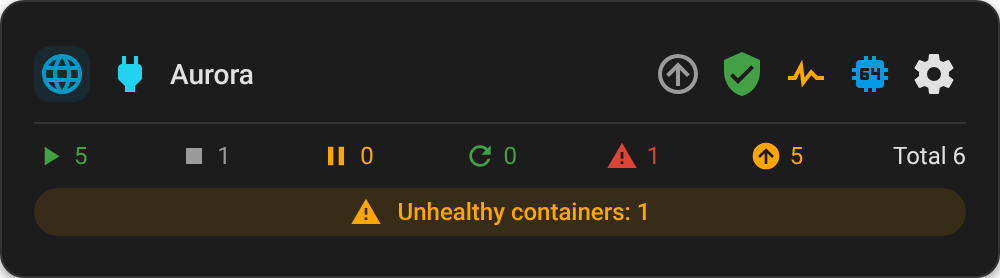
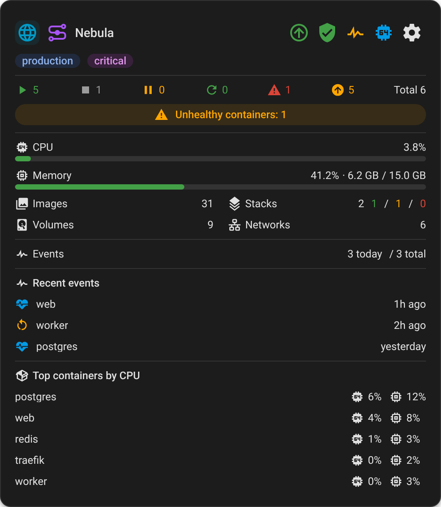
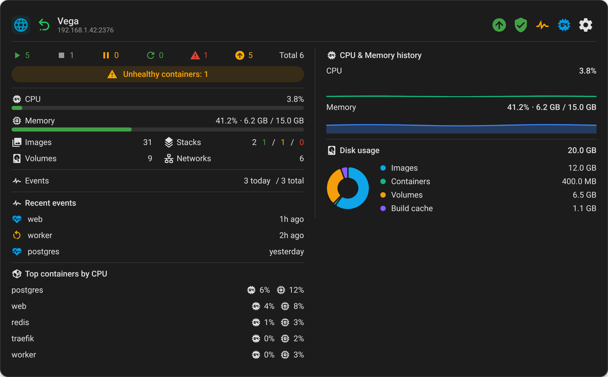

# Dockhand Environment Card

[All cards](../../README.md#cards)

```yaml
type: custom:dockhand-environment-card
device_id: <environment device>
mode: standard # compact | standard | detailed | full | custom
custom_sections: [container_counts, metrics, resources, events_summary] # only used when mode: custom
name: null # optional — Composed (from the device's area/name/floor) or Custom (plain text);
           # unset uses the device's own name, as on every card
show_settings_link: true # link to open this environment in Dockhand
```

Four built-in layouts, plus your own:

- **Compact** — name, online status and container counts
- **Standard** — adds CPU/memory, health, resource counts and events (Dockhand's own dashboard tile)
- **Detailed** — adds the top containers by CPU and recent events
- **Full** — adds a disk usage breakdown (the integration's Disk usage sensors, disabled by default) and a 15-minute CPU/memory history chart
- **Custom** — pick exactly which of those sections to show

Icons in the header show the environment's update checks (or auto-update, when on), vulnerability scanning, activity collection and metrics collection: colored when on, grey when off. Click one to change it; scanning opens the scanner choice.

<picture>
  <source media="(prefers-color-scheme: light)" srcset="../images/env-standard-light.png">
  
</picture>

<details>
<summary>Compact, detailed, and full modes</summary>
<p>
  
  
  
</p>
</details>
