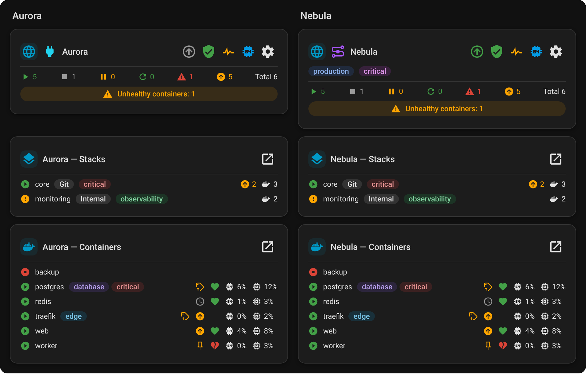

# Dockhand Overview Card

[All cards](../../README.md#cards)

```yaml
type: custom:dockhand-overview-card
show_environments: true
show_vulnerabilities: false # needs the Vulnerabilities sensor enabled per environment
show_updates: false
updates_hide_when_no_updates: false # hide an environment's Updates card when it has nothing pending
show_schedules: false # each column shows its own environment's schedules
show_stacks: false
show_containers: false
```

A whole dashboard in one card: one column per environment, each stacking the sections you turn on — the Environment, Vulnerability, Updates, Schedules, Stacks and Containers cards, in that order by default. Columns sit side by side on a wide screen and stack on a narrow one. Only environments are shown by default, since with everything on the card gets tall quickly.

Both the environments and the sections can be dragged into a different order in the editor, and a pencil icon on each opens more settings:

- **On a section** — defaults for that card type in every column, such as the Environment card's layout or which row details the Stacks and Containers cards show.
- **On an environment** — settings for just that environment's column, including a different name, stored under `environments_overrides`.

<picture>
  <source media="(prefers-color-scheme: light)" srcset="../images/overview-light.png">
  
</picture>

*Environments, Stacks and Containers turned on, across two environments.*
