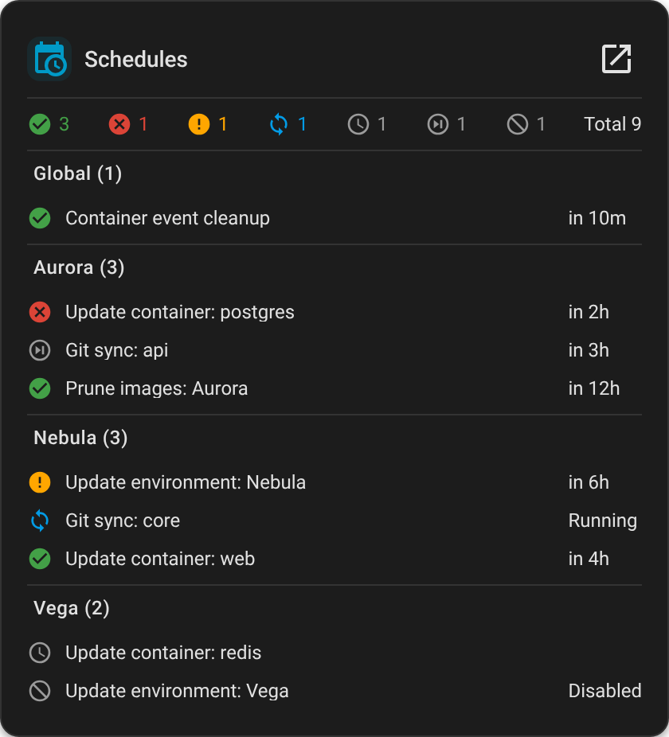

# Dockhand Schedules Card

[All cards](../../README.md#cards)

```yaml
type: custom:dockhand-schedules-card
group_by: environment # none | environment | type | status
sort_by: status # name | next_run | status
environments_order: [] # environment display order; all environments are included by default
exclude_device_ids: [] # environments to leave out
name: null # optional — Composed or Custom, same as every other card's Name field
show_settings_link: true # link to view schedules in Dockhand
show_stats: true # row of counts: success, failed, warning, running, queued, skipped, disabled, total
visible_badges: [next_run, environment] # per-row details (the environment pill is hidden when grouped by environment); add `controls` for Run now and enable/disable buttons
filters: {} # which rows show — see lists.md
show_filtered_count: true # a "Hidden by filters" line under a filtered list
```

Every Dockhand schedule — container auto-updates, git stack syncs, update checks, image prunes, backups and system jobs — for the environments you choose, with each one's status and next run. Grouping schedules by environment needs ha-dockhand 1.9.0 or later; on older releases every schedule shows regardless of the environments chosen.

**Controls**, under **Row details** and off by default, adds a pause or resume button and **Run now**, which asks first, to each row, in that order and with the icons Dockhand's Schedules page uses, for the schedules Dockhand offers them on. Container update and Git stack sync schedules are turned on and off with the container's and stack's own switches instead, so they only get Run now. Needs ha-dockhand 2.0.0 or later.

Global schedules (ones not tied to an environment) show by default; the **Where** filter shows only those, or leaves them out. Older configs with `include_global: false` keep leaving them out, and the editor rewrites them as that filter.

<picture>
  <source media="(prefers-color-scheme: light)" srcset="../images/schedules-light.png">
  
</picture>
