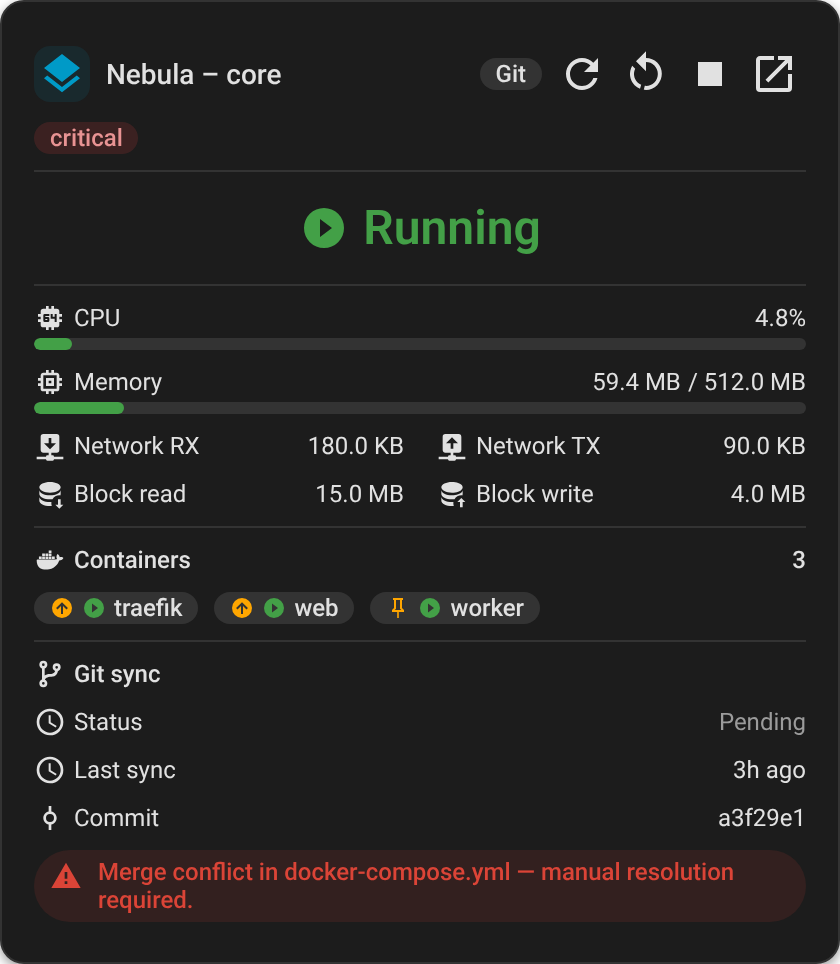

# Dockhand Stack Card

[All cards](../../README.md#cards)

```yaml
type: custom:dockhand-stack-card
device_id: <stack device>
name: null # optional — Composed or Custom, same as every other card's Name field
icon: null # optional — custom header icon (e.g. mdi:layers-triple); defaults to mdi:layers
show_settings_link: true # link to open this stack in Dockhand
show_controls: true # start/stop/restart buttons in the header — off hides them
visible_sections: [status, metrics, io, containers, git_sync] # which sections show, independent of each other
```

Under the header, the stack's Dockhand tags as coloured pills (when it has any). The stack's status, CPU/memory and network/disk I/O totals, its containers (each one a pill that opens that container, with its update icon when one is pending, then its state icon in the Container card's colors), pending updates, and — for git stacks — sync status, last sync time and any sync error. The totals are Dockhand's own (the same numbers its Stacks page shows), from ha-dockhand 1.11.0's stack stats sensors — they need Dockhand 1.0.52 or later and ha-dockhand's **Enable container and stack stats** option; without them the card simply leaves those sections out. Like Dockhand, memory shows as usage over limit, where the limit is the largest single container limit (usually the host's memory).

Buttons in the header redeploy (internal stacks) or deploy / sync from Git (git stacks), start, restart and stop the stack, in the order Dockhand's own stacks list shows them; each one's tooltip names it. Everything except Start asks for confirmation first. A stack containing a system container (Dockhand itself, or a Hawser agent) has no buttons, matching Dockhand.

<picture>
  <source media="(prefers-color-scheme: light)" srcset="../images/stack-light.png">
  
</picture>
