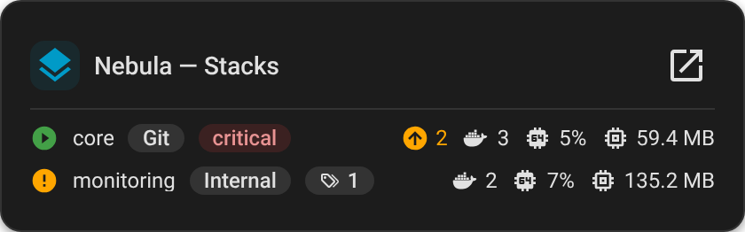

# Dockhand Stacks Card

[All cards](../../README.md#cards)

```yaml
type: custom:dockhand-stacks-card
environments_order: [] # environment display order; all environments are included by default
exclude_device_ids: [] # environments to leave out
name: null # optional — Composed or Custom, same as every other card's Name field
show_settings_link: true # link to view stacks in Dockhand
show_controls: false # the Stack card's buttons on each row
visible_badges: [container_count, updates, cpu, memory, type, tags] # per-row details; add `environment` for an environment pill
group_by: environment # none | environment | status | type
sort_by: name # name | status | containers | cpu | memory (most first)
filters: {} # which rows show — see lists.md
show_filtered_count: true # a "Hidden by filters" line under a filtered list
```

Every stack in one environment, several, or all of them, one compact row each: status, type, container count, pending updates, and CPU and memory in use (when stack stats are enabled; memory as an amount, as Dockhand's stacks list shows it). Each of those details can be turned off under **Row details** in the editor. Choosing environments works the same way on every multi-environment card — see [Choosing environments](lists.md#choosing-environments).

**Show controls** adds the Stack card's buttons to each row: deploy, start while stopped, and restart and stop while running, asking before anything but Start. It's off by default so a stray tap on a list can't stop anything. System stacks get none, as on the Stack card.

<picture>
  <source media="(prefers-color-scheme: light)" srcset="../images/stacks-list-light.png">
  
</picture>
