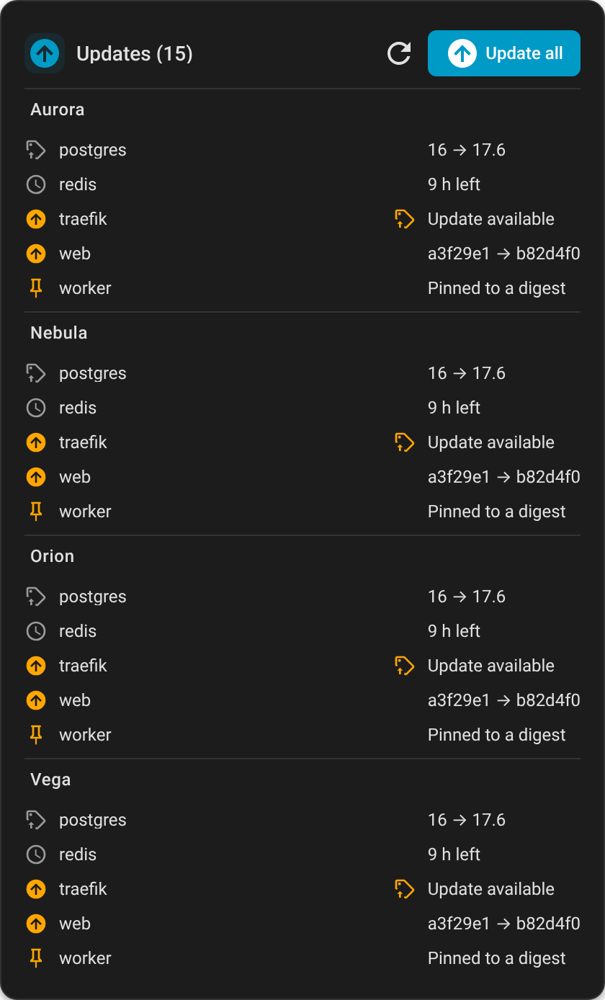

# Dockhand Updates Card

[All cards](../../README.md#cards)

```yaml
type: custom:dockhand-updates-card
group_by: environment # none | environment
environments_order: [] # environment display order; all environments are included by default
exclude_device_ids: [] # environments to leave out
name: null # optional — Composed or Custom, same as every other card's Name field
hide_when_no_updates: false # hide the whole card when nothing is pending (still shown while editing)
filters: {} # which rows show — see lists.md
show_filtered_count: true # a "Hidden by filters" line under a filtered list
```

Every pending container update across the environments you choose, with **Check for updates** and **Update all** buttons in the header. Update all installs every update the card lists that Home Assistant can install, as one Dockhand job per environment; like Dockhand's own Update all, that leaves out system containers, newer tags, pinned digests and held updates (the button is disabled, with a tooltip saying why, when that's everything listed). Click a row to open that container's update dialog and install just that one.

A newer version tag (one you'd move to by changing the container's image tag rather than installing from Home Assistant) gets a grey tag icon in place of the update icon when it's the row's only update. When it's waiting behind an update that can be installed now, an orange tag icon in its own column shows it, the tag in its tooltip. Two more kinds of row, both as Dockhand's own containers list shows them: a container pinned to a digest (`image:tag@sha256:…`) whose tag has moved on gets an orange pin and "Pinned to a digest" (the update is changing the pin, so there's nothing to install), and an update Dockhand is holding until the new image reaches its minimum image age gets a grey clock and the hours left, so you can see it coming ("At next check" once the wait is over, until Dockhand's next update check offers it). Both count in the header, and keep the card showing when **Hide when no updates** is on. Needs ha-dockhand 1.11.0 or later.

Updates are grouped by environment by default; `group_by: none` shows one combined list.

With filters set, the header counts the updates listed, and while filters hide some updates the button reads **Update listed** and installs only those shown. **Hide when no updates** still goes by everything pending, so a filtered card with nothing to list stays, saying so.

<picture>
  <source media="(prefers-color-scheme: light)" srcset="../images/updates-light.png">
  
</picture>
