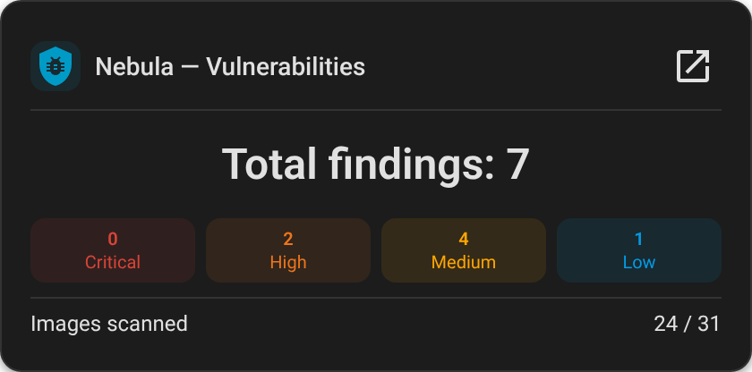
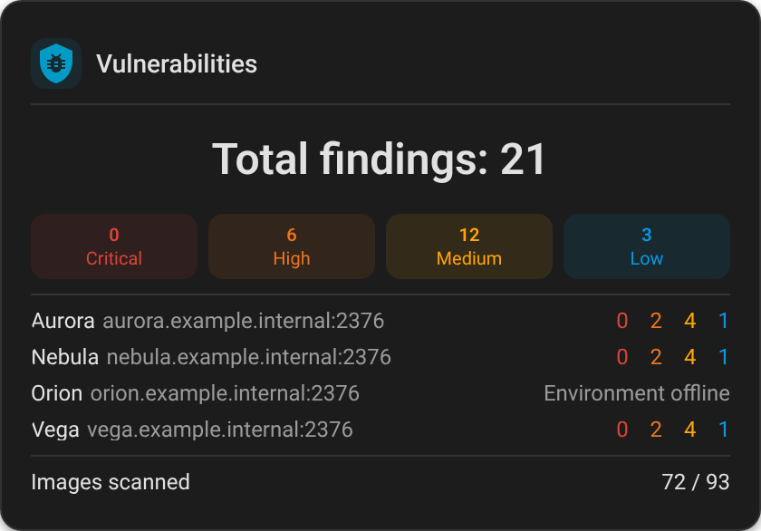

# Dockhand Vulnerability Card

[All cards](../../README.md#cards)

```yaml
type: custom:dockhand-vulnerability-card
exclude_device_ids: [] # environments left out (all shown by default)
environments_order: [] # order of the environments' rows
name: null # optional — Composed (one environment) or Custom, same as the Environment card's own Name field
show_settings_link: true # link to view vulnerabilities in Dockhand
```

With one environment shown: its total findings with a critical/high/medium/low breakdown, and how many images have been scanned. With more: their findings added up, and a row per environment with its critical, high, medium and low counts, lined up in columns (click a count for its sensor). Dockhand counts per environment, so an image running in two environments counts in both. Choose the environments at the top of the editor, as in the list cards. Needs each environment's **Vulnerabilities** sensor enabled in Home Assistant (it's disabled by default; so are **Critical**, **High**, **Medium** and **Low vulnerabilities** and **Scanned images**, which the card shows when they're on) and vulnerability scanning turned on for that environment in Dockhand.

A card from before 2.0.0 with `device_id` keeps showing just that environment; the editor turns it into `exclude_device_ids` with your next change.

<picture>
  <source media="(prefers-color-scheme: light)" srcset="../images/vulnerability-light.png">
  
</picture>

<picture>
  <source media="(prefers-color-scheme: light)" srcset="../images/vulnerability-rollup-light.png">
  
</picture>
