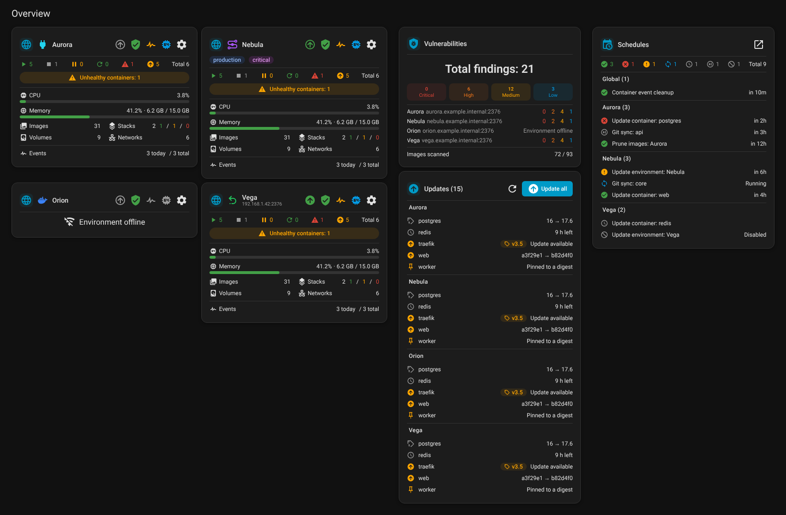
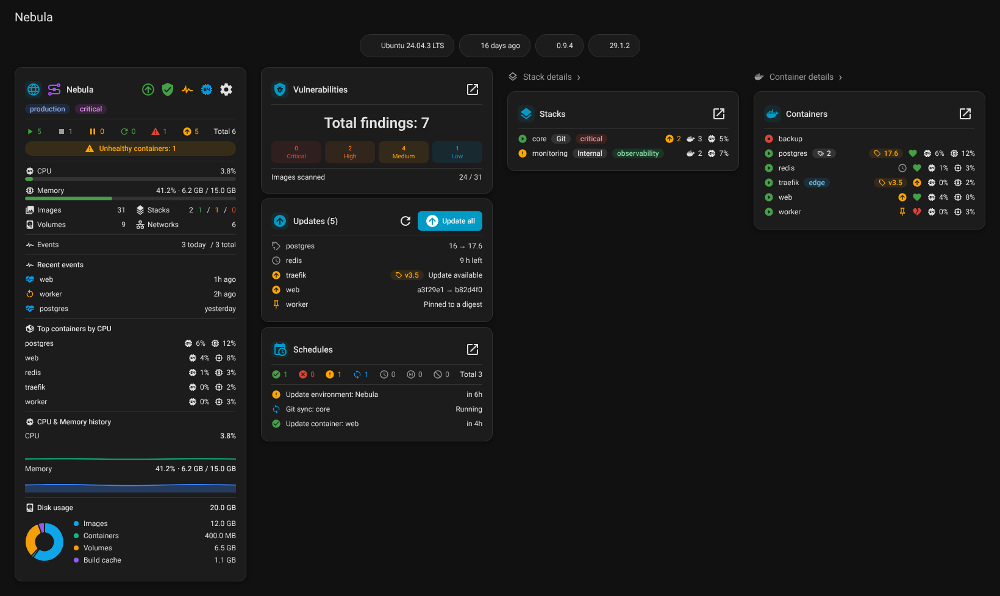
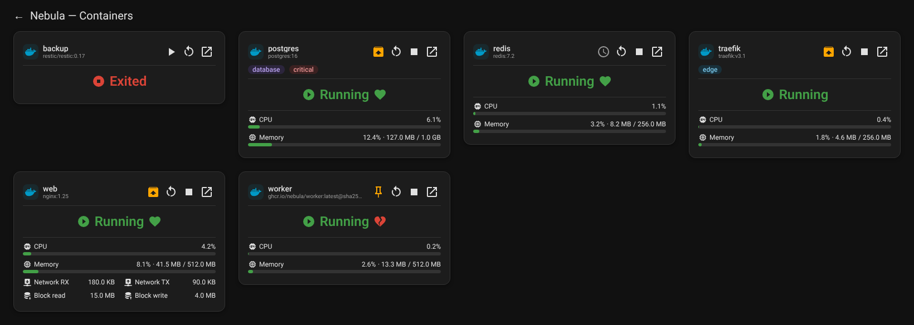
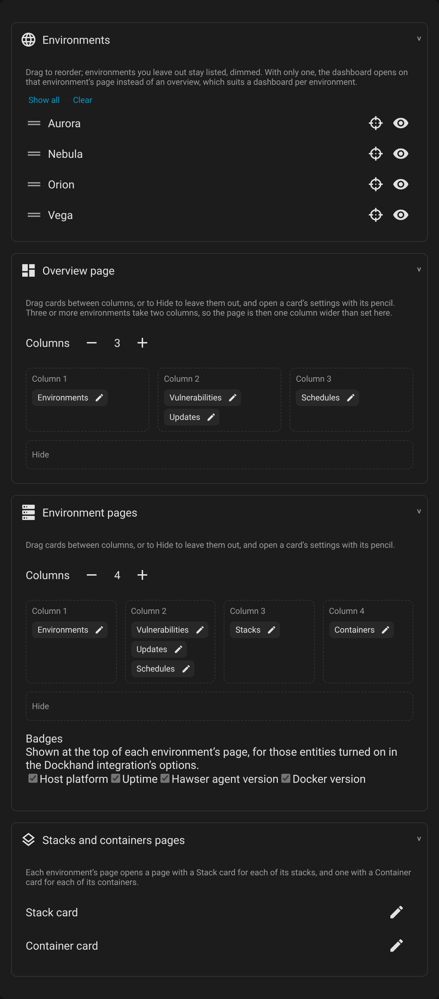

# Dockhand dashboard

A ready-made dashboard instead of building one card by card: in **Settings → Dashboards → Add dashboard**, pick **Dockhand** under Community dashboards. Home Assistant builds it from the [cards](../README.md#cards) each time it opens, so it keeps up by itself as environments, stacks and containers come and go in Dockhand.

**The overview** shows your environments (in one column for one or two, two columns from three), with vulnerabilities across all environments, pending updates and schedules beside them. Each environment has a tab of its own beside **Overview**, so you can go from one to the next in a click.

<picture>
  <source media="(prefers-color-scheme: light)" srcset="images/dashboard-overview-light.png">
  
</picture>

**An environment's page** has all its cards, below badges for its host platform, uptime, Hawser agent version and Docker version (each once that entity is turned on in the integration's options, and chosen in the dashboard's settings). With a single environment, its page is the whole dashboard.

<picture>
  <source media="(prefers-color-scheme: light)" srcset="images/dashboard-environment-light.png">
  
</picture>

**Stack details** and **Container details**, above its Stacks and Containers cards, open a page with a Stack card for each of the environment's stacks, or a Container card for each of its containers.

<picture>
  <source media="(prefers-color-scheme: light)" srcset="images/dashboard-containers-light.png">
  
</picture>

To change it, open the dashboard's **⋮ → Edit dashboard**:

- **Dockhand instance** (only with more than one): one instance's environments, or all of them.
- **Environments**: their order, and which to leave out. With only one, the dashboard opens on that environment's page instead of an overview, which suits a dashboard per environment.
- **Overview page** and **Environment pages**: up to four columns each; drag cards between columns, or to **Hide** to leave them out. On the overview, three or more environments take two columns, so the page is one column wider than the number set. A card's pencil opens its own settings, the same as in that card's editor. Every environment's page shares them: change the Containers card on one and it changes on all. The environment pages also choose which badges to show.
- **Stacks and containers pages**: the settings of the Stack card on every Stacks page, and of the Container card on every Containers page.

<picture>
  <source media="(prefers-color-scheme: light)" srcset="images/dashboard-settings-light.png">
  
</picture>

The screenshots use made-up data; the page around the cards is drawn to look like Home Assistant's.

Anything beyond that needs **Take control**, which turns it into a normal dashboard you edit like any other (it then stops updating itself). In YAML it's:

```yaml
strategy:
  type: custom:dockhand
  # Everything below is optional.
  exclude_device_ids: [] # environments to leave out
  overview_layout: [[environments], [vulnerabilities, updates], [schedules]]
  environment_layout: [[environments], [vulnerabilities, updates, schedules], [stacks], [containers]]
  cards: # each card's own settings, by page
    overview:
      schedules: { show_stats: true }
    environment:
      containers: { show_controls: true }
    stack: { visible_sections: [status, metrics, containers] }
    container: {}
```
